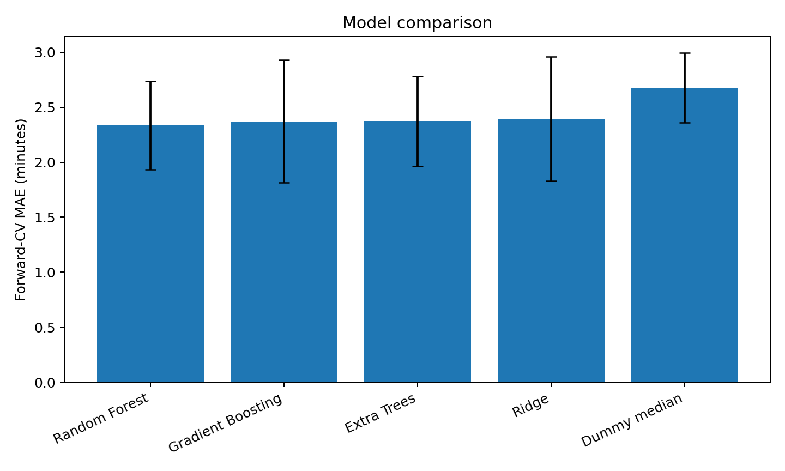

# Machine-Learning Prediction of Aircraft Taxi Time


## Problem

Predict the time from first aircraft movement to takeoff at Barcelona-El Prat Airport using accessible flight and hourly weather information. The project tests what is possible without airport-surface surveillance, stand-to-runway geometry or proprietary operational feeds.

## Original course project

The course investigation was co-authored by Costin Boiciuc and Omid Kouhifaeghdehkordi. It expanded from a small manual proof of concept to an automatically collected dataset, compared linear and tree-based regressors and used chronological evaluation. The submitted report selected a Random Forest and reported MAE = 1.831 min, RMSE = 2.315 min and R-squared = 0.269.

Those values are retained as the historical course result, not as the benchmark for the refactored public code. The repository audit identified future-derived features and reuse of the original holdout during feature selection. See [MODEL_AUDIT.md](MODEL_AUDIT.md).

## Audited public pipeline

The refactored pipeline:

- separates Flightradar24 collection, Open-Meteo enrichment, model-table preparation and training;
- reads the API credential only from the `FR24_API_TOKEN` environment variable;
- defines one explicit feature-availability policy;
- excludes completed taxi distance, actual takeoff runway, future-derived queue size and direct target fields;
- compares a median baseline, Ridge, Random Forest, Extra Trees and Gradient Boosting;
- evaluates models with five-fold forward-chaining cross-validation;
- generates fold metrics, aggregate results, out-of-fold predictions, plots and a fitted model;
- includes automated tests that prevent forbidden features entering the public feature list.

### Verified local result

The supplied table contained 477 chronological rows; one observation above 60 minutes was removed by the documented quality rule.

| Model | Forward-CV MAE | Forward-CV RMSE | Mean R-squared |
|---|---:|---:|---:|
| Random Forest | **2.336 ± 0.402 min** | **3.160 ± 0.624 min** | **0.187** |
| Median baseline | 2.675 ± 0.317 min | 3.547 ± 0.431 min | -0.027 |

No untouched final-test claim is made; the next independent benchmark requires a newly collected future period. Machine-readable results are in `results/verified_metrics.json`.



## Run locally

### 1. Install training dependencies

```bash
python -m venv .venv
source .venv/bin/activate       # Windows: .venv\Scripts\activate
pip install -r requirements.txt
python -m unittest discover -s tests -v
```

### 2. Collect and prepare new data

Collection requires an authorised Flightradar24 API subscription. Export the rotated token in your shell; do not paste it into Python or a notebook.

```bash
pip install -r requirements-collection.txt
export FR24_API_TOKEN="your-rotated-token"  # PowerShell: $env:FR24_API_TOKEN="..."

python -m data_collection.collect_fr24 \
  --start-date 2026-05-01 \
  --end-date 2026-05-07 \
  --output data/private/fr24_departures.csv

python -m data_collection.add_weather \
  --input data/private/fr24_departures.csv \
  --output data/private/departures_weather.csv

python -m data_preparation.build_model_table \
  --input data/private/departures_weather.csv \
  --output data/private/model_table.csv
```

### 3. Train and evaluate

```bash
python -m training.train \
  --data data/private/model_table.csv \
  --output-dir results
```

The dataset is not public yet. See [data/README.md](data/README.md) for the remaining redistribution decision.

## Repository layout

```text
data_collection/        Flightradar24 acquisition and Open-Meteo enrichment
data_preparation/       raw-to-model feature construction
training/               feature policy, forward validation and final fitting
tests/                  feature-policy and preparation tests
results/                generated metrics, predictions, plots and fitted model
data/README.md          private-data layout and publication status
MODEL_AUDIT.md          reproducibility findings and limitations
```
